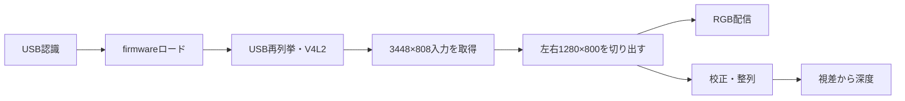

# PS4 EyeをUSBステレオカメラとして扱う

## 概要

PS4 Eyeは左右二つの映像を使えるカメラです。ここでは、USBで認識する段階、firmwareをロードして映像用デバイスにする段階、Pythonで画像を取得する段階、左右の対応から深度を計算する段階を分けて説明します。

**実機確認済み**なのはUSB認識と保存ファイル/設定です。**映像取得・配信・距離精度は未検証**で、保存された撮影画像や校正値があることだけから現在の撮影成功を断定しません。

## 背景・仕組み

左右のカメラが同じ物体を見ると、物体の像は左右画像の異なる位置に現れます。そのずれが視差です。内部パラメータと左右の配置を校正し、画像を整列すると、横方向の対応を探すステレオマッチングから距離を推定できます。firmwareやUSBの初期化はこの計算以前の準備です。

## 対象コードと環境

上流カメラrepoの保存commitは`4180061a1afd109a9204557f256d341c5850c124`です。それとは別にホーム直下に独自スクリプト6本があり、こちらが1280幅の左右切り出しと実機校正NPZを使います。上流同梱viewerの1264幅切り出しや単眼用param_*.npyと混同しません。

基準はPython3.6.9、OpenCV4.1.1、NumPy1.13.3、Flask0.12.2、PyUSB1.0.0、L4T32.7.1です。独自コードはユーザーの保全指示により [src/ps4-eye](../../../src/ps4-eye/README.md) へ配置しました。第三者の上流コード一式とfirmwareの許諾は別で、転載していません。校正バイナリ/画像/firmwareは非公開保全先から復元するため、公開repoだけで映像取得まで完結するわけではありません。

## 実装・再構築の順序

1. [firmwareとUSB](firmware.md)：標準UVC/ライブラリ → firmware配置 → 将来のロード → USB/V4L2確認。
2. [撮影と配信](capture.md)：独自コード配置 → YUYV要求と切り出し → RGB配信。
3. [ステレオ深度](stereo-depth.md)：校正データ配置 → 整列 → 視差/距離 → 必要時だけ別作業で再校正。

各記事のコマンドは将来の動作確認用です。今回の編集ではカメラにアクセスせず、firmwareロードも実行していません。

## 動作確認の段階

USBで見つかること、videoノードができること、フレームを読めること、左右画像が正しいこと、深度が妥当であることを別々に判定します。保存時の状態は`05a9:0580`、5000M、vendor-specific interface、driver欄空、videoノードなしでした。

PS4専用udev/systemd自動起動は既存検索範囲で見つかっていません。JetPackの一般的なhubルールをカメラ専用設定と呼ばず、まず手動の工程で切り分けます。

## 参照資料

- [出典S5・S6・S7](../../../reference/sources.md)
- [検証済み/未検証の一覧](../../../reference/validation-results.md)、[版一覧](../../../reference/environment-versions.md)
